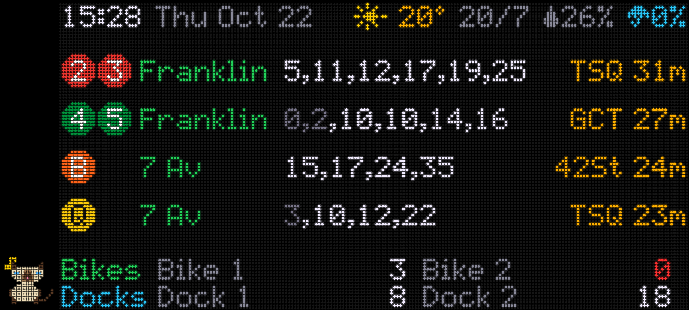
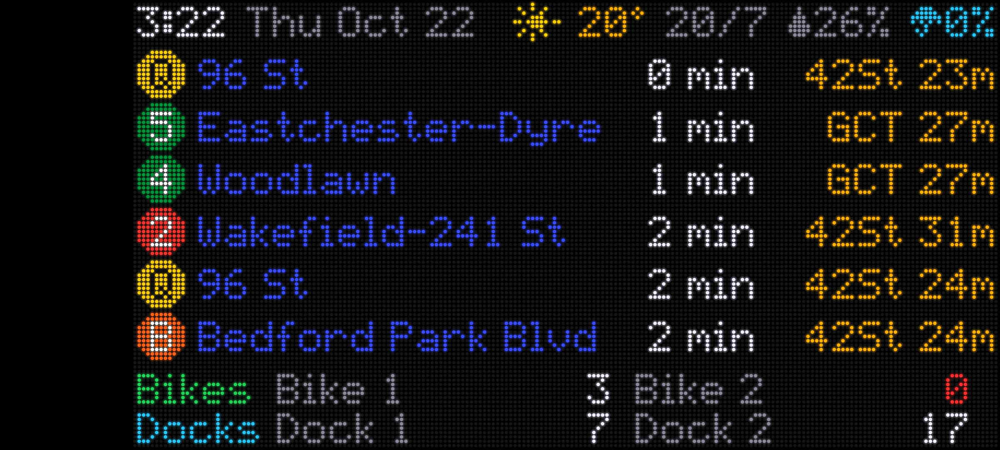

# subway-board

An LED-matrix-style NYC subway, Citi Bike and weather board for an old Android phone.
A Node server runs in **Termux** on the phone, and Chrome (installed as a home-screen app) shows
`http://localhost:8080`. Any other device on the same Wi-Fi (iPad, laptop) can open
`http://<phone-ip>:8080` in a browser.




Live data, taken on the phone (the black strip on the left is the `?mask=camera` setting).
See [docs/LAYOUT.md](docs/LAYOUT.md) for the layout.

## Data sources (no API keys)

| Data | Source | Refresh |
|---|---|---|
| Subway | MTA GTFS-Realtime: `nyct/gtfs` (2/3/4/5), `gtfs-bdfm` (B), `gtfs-nqrw` (Q) | 60 s |
| Citi Bike | GBFS `station_information` / `station_status` (`gbfs.lyft.com/.../bkn`, then `gbfs.citibikenyc.com`) | 60 s |
| Weather | Open-Meteo, ZIP 11238 (40.6797, -73.9641), °C: icon, temp, hi/lo, humidity, rain chance next 3 h | 10 min |
| Stop names | MTA static GTFS `stops.txt` → `data/stops.json` (`npm run fetch-stops`) | once |

Configured stations, Manhattan-bound only (`config.json` → `subway[].show`):

| Row | Departures shown | Dimmed (too soon to catch) | Travel time to |
|---|---|---|---|
| 2/3 Franklin Av `239N` | all in next 15 min, at least 6 | under 5 min | TSQ (Times Sq) |
| 4/5 Franklin Av | all in next 15 min, at least 6 | under 5 min | GCT |
| B 7 Av `D25N` | all in next 25 min, at least 4 | under 10 min | 42St (Bryant Pk) |
| Q 7 Av | all in next 25 min, at least 4 | under 10 min | TSQ |

Citi Bike (`config.json` → `citibike`):

| Label | Station | short_name |
|---|---|---|
| Bike 1 | Sterling Pl & Classon Ave | 4033.18 |
| Bike 2 | Lincoln Pl & Classon Ave | 3960.01 |
| Dock 1 | Park Pl & Carlton Ave | 4125.13 |
| Dock 2 | Park Pl & Vanderbilt Ave | 4083.13 |

## Run on a PC (development)

```bash
npm install
npm run mock         # fake data, no network needed
npm run fetch-stops  # destination names
npm start            # live data
```

Open http://localhost:8080. Tap the screen to switch between the `list` and `next` styles.

## Changing Citi Bike stations

```bash
npm run find-station -- --zip               # 10 nearest to ZIP 11238
npm run find-station -- "eastern pkwy"      # name search
npm run find-station -- --near 40.6741,-73.9580 15
```

Put the `short_name` (first column) into `config.json` → `citibike.bikes[]` / `citibike.docks[]`
→ `"station"`, and a short `"label"` (about 10 characters) for the screen.

## Phone setup

1. Phone: turn on Developer options and USB debugging. Get **Termux** and **Termux:Boot** from
   their GitHub releases (`termux/termux-app`, `termux/termux-boot`; not the Play Store).
   Open Termux:Boot once.
2. PC: `bash scripts/adb-setup.sh [apk files...]`. This installs any APKs you pass, keeps the
   screen on while charging, turns auto-rotate on, exempts the apps from battery optimisation,
   and copies the project to `/sdcard/Download/subway-board`.
3. Termux on the phone:
   ```bash
   termux-setup-storage
   cp -r ~/storage/downloads/subway-board ~/
   bash ~/subway-board/scripts/termux-setup.sh
   bash ~/subway-board/scripts/start.sh
   ```
4. In Chrome open `http://localhost:8080/?mask=camera` once, then menu → **Install app**.
   The "Subway" icon opens the board full screen, landscape only.

Once Termux:Boot is set up, the server starts automatically after a reboot
(`~/.termux/boot/subway-board.sh`); tap the Subway icon to bring the board back.

## Per-device URL settings (remembered by each browser)

| Parameter | Effect |
|---|---|
| `?mask=camera` | 8 % black strip on the front-camera side (cut-out included), follows rotation (the S21 has a broken corner there) |
| `?mask=left` / `?mask=right` | strip on a fixed side |
| `?mask=none` | no strip (default) |
| `?cat=top` / `?cat=bottom` / `?cat=off` | Siamese cat walking along the strip (feet on the screen edge) from this end to 80 % of the way, staying out of the 20 % by the S21's broken corner; default picks the end away from it. With `?mask=camera` it is a liquid and flows around the punch-hole camera |
| `?style=list` / `?style=next` | subway style (tapping the board also switches) |

With a strip on, the opposite edge keeps a thin 2.5 % black margin so the S21's rounded corners
(90 px radius) don't clip the board's corner dots.

**Night** (`display.night`, default 01:00-08:00): the screen is fully black; tap it to see the
board for 30 s. After an update the open board reloads itself within 30 s (the server reports a
code version in `/api/data`).

Every few minutes the whole panel shifts by up to half a dot (`display.pixelShiftMinutes`) to
spread OLED wear.

## Files

```
server.js            HTTP server: public/ + GET /api/data
config.json          stations, 42 St targets, Citi Bike stations, weather location, refresh
lib/mta.js           GTFS-RT fetch/decode, arrivals per route, travel time to 42 St
lib/citibike.js      GBFS fetch, station lookup (station_id / short_name / name)
lib/weather.js       Open-Meteo current (°C, humidity, icon) + today hi/lo + rain chance next 3 h
lib/mock.js          MOCK=1 fake feeds (encoded through the real protobuf path)
public/font.js       5x7 dot-matrix font
public/led.js        canvas LED matrix renderer
public/app.js        layout + polling (ES5, for old WebViews)
public/cat.js        Siamese pixel cat that walks along the masked strip
public/icon-*.png    app icons (scripts/make-icons.js)
scripts/             fetch-stops, find-station, make-icons, termux-setup, start, adb-setup
```
